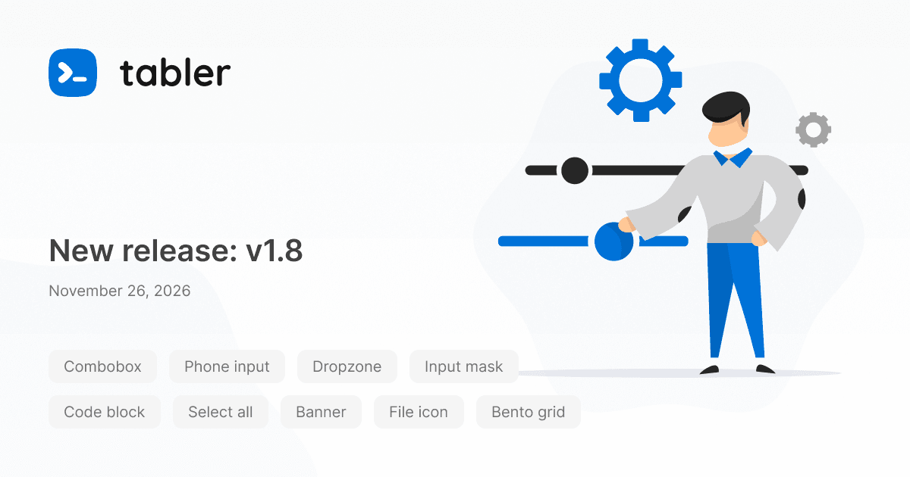
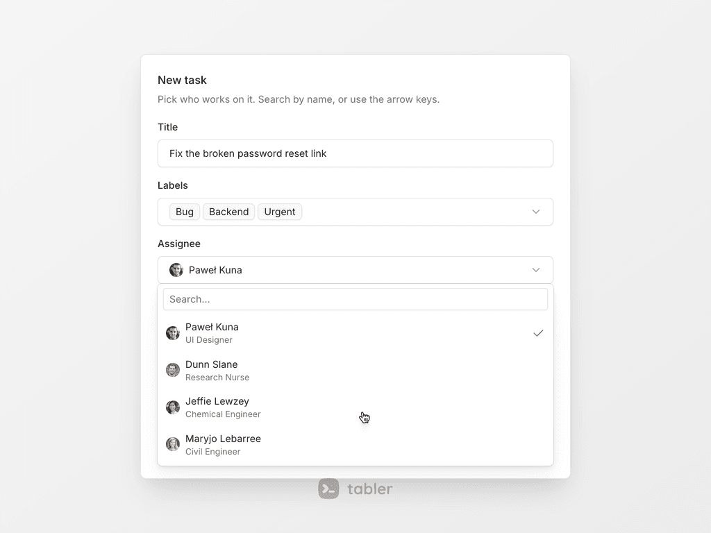
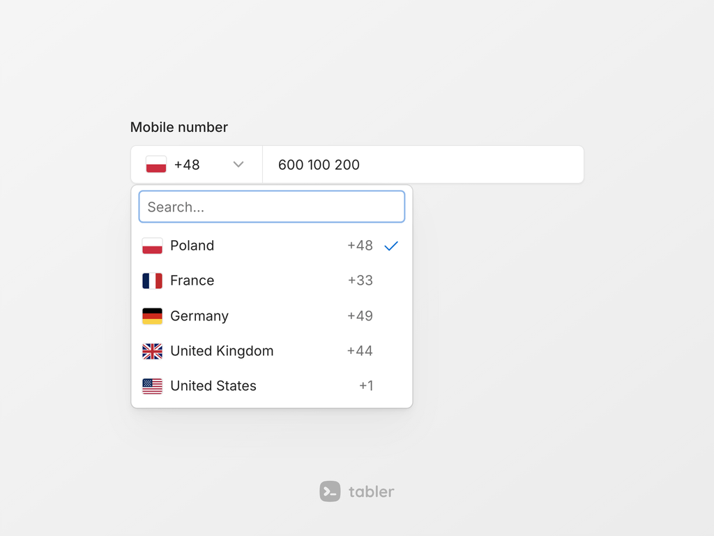
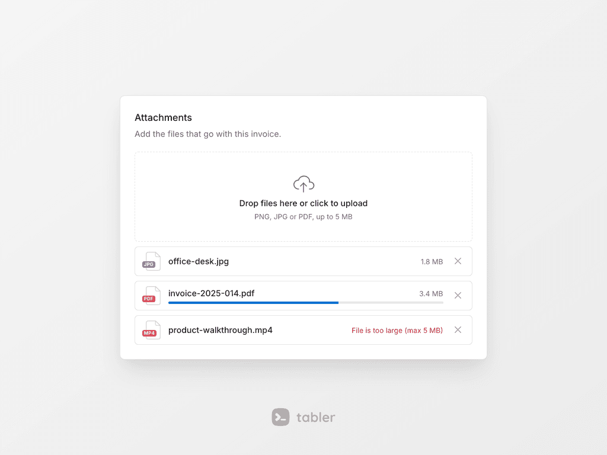
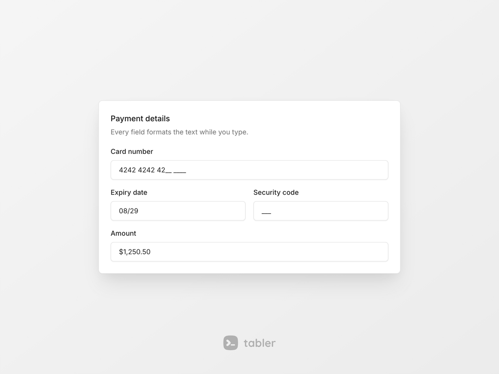
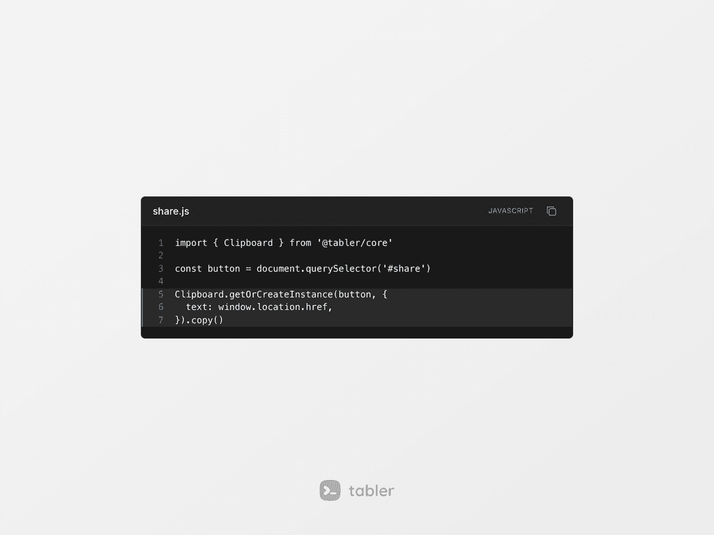
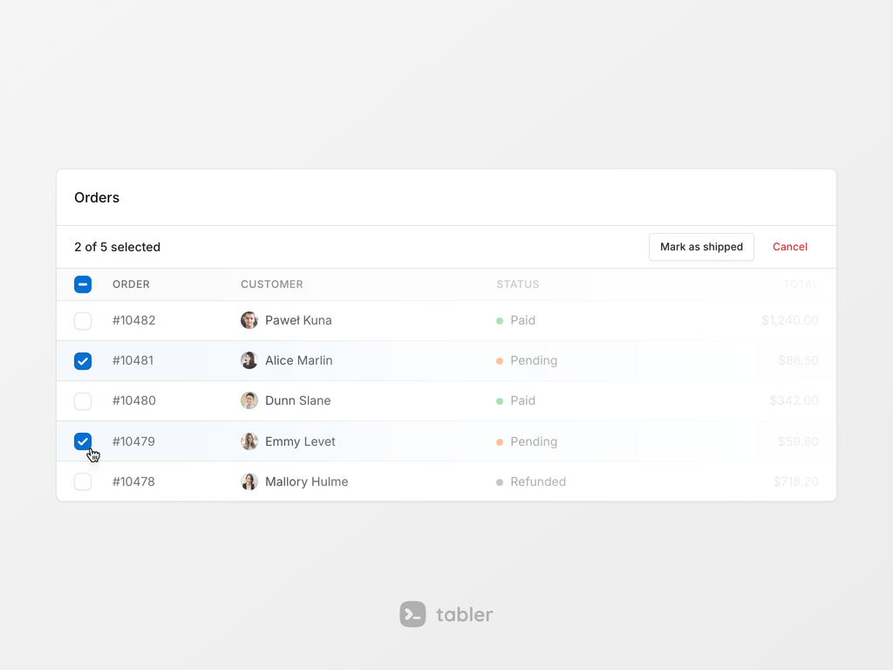
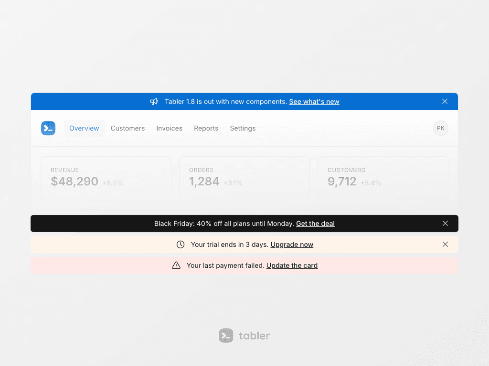
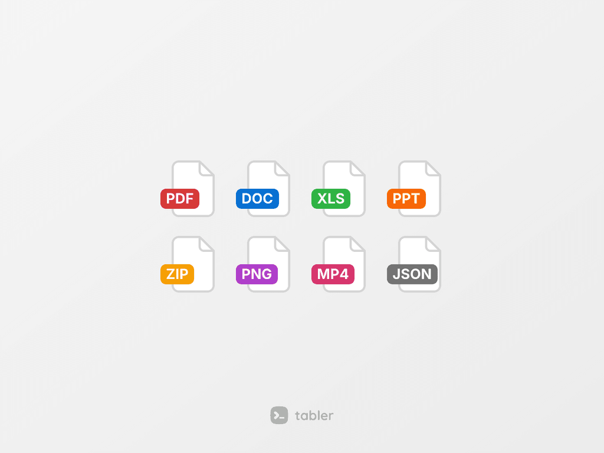

<picture>
  <source media="(prefers-color-scheme: dark)" srcset="https://raw.githubusercontent.com/tabler/tabler/dev/.github/release-notes/1.8.0-cover-dark.png">
  
</picture>

Tabler 1.8 is out. It's a release about forms: a combobox that can replace a select, a phone input with a country picker, a file dropzone and an input mask, all built into `tabler.js` with no extra library. There's also a code block, a select-all plugin for tables and lists, a banner, file icons and a bento grid. On top of that there are about sixty smaller changes: stacked modals, about twenty new groups of utilities, CSS variables for more components and a round of work on motion and accessibility.

## Combobox

<picture>
  <source media="(prefers-color-scheme: dark)" srcset="https://raw.githubusercontent.com/tabler/tabler/dev/.github/release-notes/1.8.0-combobox-dark.png">
  
</picture>

A field that looks like a select, but its options are ordinary HTML, so an item can hold an icon, a description, a badge or an avatar. Add `data-bs-toggle="combobox"` to a `<select class="form-select">` and the combobox builds the toggle and the menu from its options, with a search field. The `<select>` stays in the DOM and fires a normal `change` event, so forms and validation work as before. You can also write the menu yourself, as a `.combobox-toggle` button followed by a `.dropdown-menu`. It supports multiple selection with tags and full keyboard control, and it's the one to use in place of Tom Select.

## Phone input

<picture>
  <source media="(prefers-color-scheme: dark)" srcset="https://raw.githubusercontent.com/tabler/tabler/dev/.github/release-notes/1.8.0-phone-input-dark.png">
  
</picture>

A telephone field with a country picker in front of it, showing flags and dial codes. Add `data-bs-toggle="phone-input"` to an `<input type="tel">` and pick the start country with `data-bs-country`. The picker is a combobox, so it has search and keyboard support. The number is formatted as you type, a pasted number that starts with `+` selects its country, and the script gives you the full international number.

## Dropzone

<picture>
  <source media="(prefers-color-scheme: dark)" srcset="https://raw.githubusercontent.com/tabler/tabler/dev/.github/release-notes/1.8.0-dropzone-dark.png">
  
</picture>

A file field with a large drop area and a list of the chosen files, each with its name, its size and a remove button. Add `data-bs-toggle="dropzone"` to a `.dropzone` element with a `.dropzone-area` label around a real `<input type="file">`. By default the files go out with the form, like with any file field. Set `data-bs-url` and each file is uploaded on its own, with a progress bar. The plugin is part of `tabler.js`, and Dropzone.js is deprecated.

## Input mask

<picture>
  <source media="(prefers-color-scheme: dark)" srcset="https://raw.githubusercontent.com/tabler/tabler/dev/.github/release-notes/1.8.0-input-mask-dark.png">
  
</picture>

`data-mask` no longer needs IMask. Patterns are formatted natively, with the same `0`, `a` and `*` characters. There are two new types: `data-mask-type="number"` groups thousands and keeps the fraction to a set number of digits, and `data-mask-type="date"` keeps every part of a date or a time in its range. `data-mask-ranges` limits the groups of digits of any other pattern, such as the parts of an IP address. A page that still loads IMask keeps working as before.

## Code block

<picture>
  <source media="(prefers-color-scheme: dark)" srcset="https://raw.githubusercontent.com/tabler/tabler/dev/.github/release-notes/1.8.0-code-block-dark.png">
  
</picture>

A snippet on a dark surface, with an optional header for a title and a language, and a copy button that uses the Clipboard plugin. Wrap a `pre` in `.code-block`. Add `.code-block-numbered` for line numbers and `.code-line-highlight` to point out a line, and there's a max height variant for long files. It doesn't highlight syntax itself, so put the output of Prism or Shiki inside.

## Select all

<picture>
  <source media="(prefers-color-scheme: dark)" srcset="https://raw.githubusercontent.com/tabler/tabler/dev/.github/release-notes/1.8.0-select-all-dark.png">
  
</picture>

One checkbox that checks every row of a selectable table or list. Add `data-bs-toggle="select-all"` to the wrapper and `data-bs-select-all-check` to the checkbox in the header. It turns indeterminate while only some rows are selected, and Shift-click selects a range. A `.selection-toolbar` above the table swaps the filters for bulk actions and shows the number of selected rows.

## Banner

<picture>
  <source media="(prefers-color-scheme: dark)" srcset="https://raw.githubusercontent.com/tabler/tabler/dev/.github/release-notes/1.8.0-banner-dark.png">
  
</picture>

A one-line strip above the navbar for an announcement, a trial notice or a maintenance message. A `.banner` holds the text, a link and a close button. Add `data-bs-banner-id` and a closed banner stays closed on the next visit. `tabler-theme.js` hides it before the page renders, so the page doesn't jump.

## File icon

<picture>
  <source media="(prefers-color-scheme: dark)" srcset="https://raw.githubusercontent.com/tabler/tabler/dev/.github/release-notes/1.8.0-file-icon-dark.png">
  
</picture>

A sheet of paper with the file format on a colored label, for uploads, attachments and file lists. Add `.file-icon` to an empty element and put the format in `data-type`. Common formats such as `pdf` get a color on their own, and any other format gets a gray label.

## Bento grid

<picture>
  <source media="(prefers-color-scheme: dark)" srcset="https://raw.githubusercontent.com/tabler/tabler/dev/.github/release-notes/1.8.0-bento-grid-dark.png">
  
</picture>

Cards of different sizes in one block, with edges that line up, for feature sections and dashboard overviews. Add `.grid-bento` to a `.grid`, then size each tile with `.g-col-*` for the columns and the new `.g-row-*` for the rows. Both take a breakpoint, and `--tblr-grid-bento-row-height` sets the height of a row.

---

## Modals, offcanvas and dialogs

A modal with `data-bs-stacked="true"` opens on top of the open modal instead of replacing it. Offcanvas panels close with a swipe on touch devices, `.offcanvas-inset` leaves a gap around the panel, and `--tblr-offcanvas-backdrop-blur` blurs the page behind it. The native `<dialog>` and its backdrop have open and close animations.

## JavaScript

`tabler.init(root)` starts every plugin on markup added after page load, and `tabler.dispose(root)` releases it again. `show()`, `hide()`, `toggle()` and `close()` return a Promise that resolves when the transition ends. The new `Toggler` plugin switches a class or an attribute on click with `data-bs-toggle="toggler"`, so small one-off scripts can go.

Tooltips and hover popovers stay open while the pointer is over the tip, and every tooltip and popover closes on Escape. Toggle buttons get a default `aria-pressed` on load.

## Forms

`form[data-bs-validate]` styles fields with `:user-invalid`, so an error shows only after the user has left the field, with no JavaScript. `.form-control` shows the focus ring on `:focus-within`, so a wrapper with a nested input gets it too. Check, radio and switch marks are animated. The root element sets `accent-color`, so native checkboxes, radios and range inputs without Tabler classes use the theme color.

## Utilities

About twenty new groups of utilities. For CSS grid: `.grid-cols-*`, `.grid-auto-flow-*`, `.justify-items-*`, `.place-items-*` and the responsive `.justify-self-*`. For sizes: `.min-w-0`, `.min-h-0`, `.w-fit-content` and the dynamic viewport units, such as `.dvh-100`. For text: `.text-truncate-2` to `.text-truncate-5`, `.text-balance`, `.text-pretty`, `.lh-md` and the `.underline-*` family. The rest: `.d-flow-root` and `.d-contents`, `.contains-inline` and `.contains-size` for container queries, `.color-scheme-*`, `.shadow-xs` and `.shadow-xl`, `.border-keyline`, `.transition-none`, `.animation-none`, `.hover-lift` and `.placeholder-pulse`.

## CSS variables for more components

Cards, tables, modals, dropdowns, list groups, navs, the carousel and the offcanvas have new `--tblr-*` variables, and so do loaders, the timeline, stars, placeholders, button groups, pricing, social icons, flags, payments and nav overflow. Buttons have `--tblr-btn-transition-property`, `-duration` and `-timing`.

## Colors and motion

Body text is darker: `$dark` and `$body-color` are `gray-900`, and the light mode `--tblr-body-color` is `gray-800`. The base colors from `$blue` to `$cyan` have dark mode values through `light-dark()`. Card headers, table headers and the modal footer use the `--tblr-fill-*` tokens. Inline `code` takes the color of the text around it, so it stays readable on buttons and other colored surfaces.

The `transition` mixin and the animated components emit motion only inside `prefers-reduced-motion: no-preference`.

## Demo and docs

The demo has a shopping cart page, pages for every new component, a delete repository modal with typed confirmation, a weekly metrics card and a new notifications dropdown with avatars and day groups. Tabler Icons are at 3.50.

The docs have pages for every new component and plugin, a new Tabler Flags section and a section on `tabler.init()` and `tabler.dispose()` on the installation page.

## Upgrading

For most projects 1.8 is a version bump. Every class, data attribute and JavaScript export from 1.7 is still there, and a page that loads the compiled CSS and JS needs no change to its markup.

Two things can touch your code. The base colors are `light-dark()` values now, so the deprecated `--tblr-{color}-rgb` custom properties of the base and theme colors, such as `--tblr-primary-rgb`, are no longer emitted. Use `color-mix(in srgb, var(--tblr-primary) 50%, transparent)` instead. For the same reason Sass color functions such as `color.adjust()` and `rgba()` can't read `$primary`, `$blue` and the other base colors. Tabler's `tint-color()`, `shade-color()` and `mix-color()` still work on them.

Three things are deprecated and stay until 2.0. Dropzone.js: `dist/libs/dropzone` and its styles in `tabler-vendors.css` remain, so existing pages keep working, and the Dropzone plugin replaces it. IMask: a page that loads it still sends plain `data-mask` patterns to IMask; add `data-mask-type="pattern"` to use the native mask. The `$btn-transition` Sass variable is split into `$btn-transition-property`, `$btn-transition-duration` and `$btn-transition-timing`.

The `.underline-*` utilities are new names for `.link-underline*` and `.link-offset-*`, `.lh-md` is an alias of `.lh-base`, and `.placeholder-pulse` of `.placeholder-glow`. The old classes still work.

`show()`, `hide()`, `toggle()` and `close()` return a Promise now. Projects that lint with `@typescript-eslint/no-floating-promises` need to mark the calls they don't await with `void`, for example `void modal.show()`.

Some things look a little different: body text is darker, inline `code` follows the text color, and check, radio and switch marks animate. Check custom styles that sit close to them.

Every change, with a before and after example, is in the [Upgrade to 1.8](https://docs.tabler.io/ui/getting-started/upgrade/1-8) guide.
